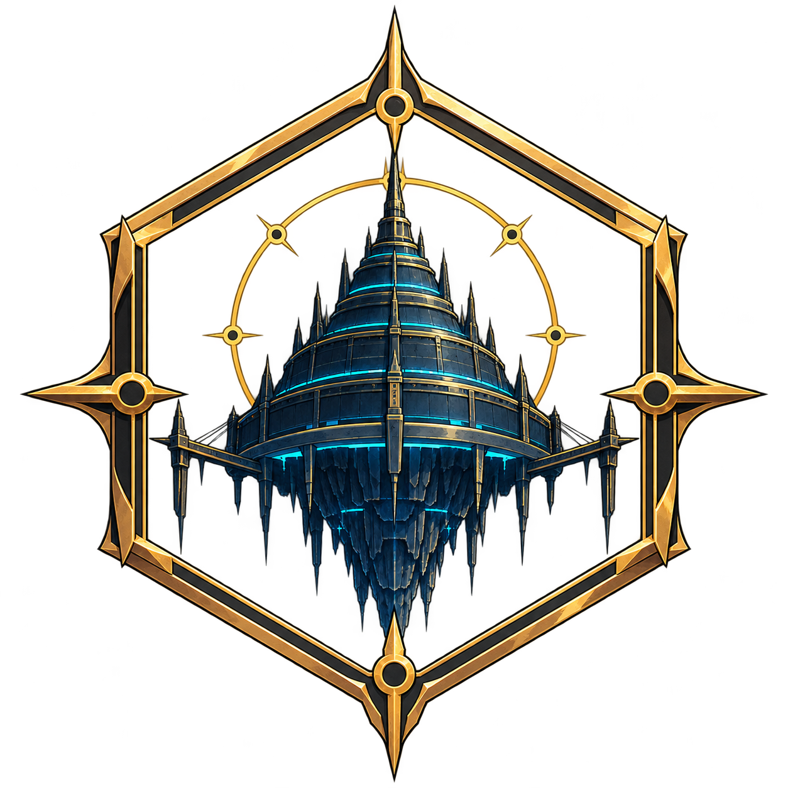
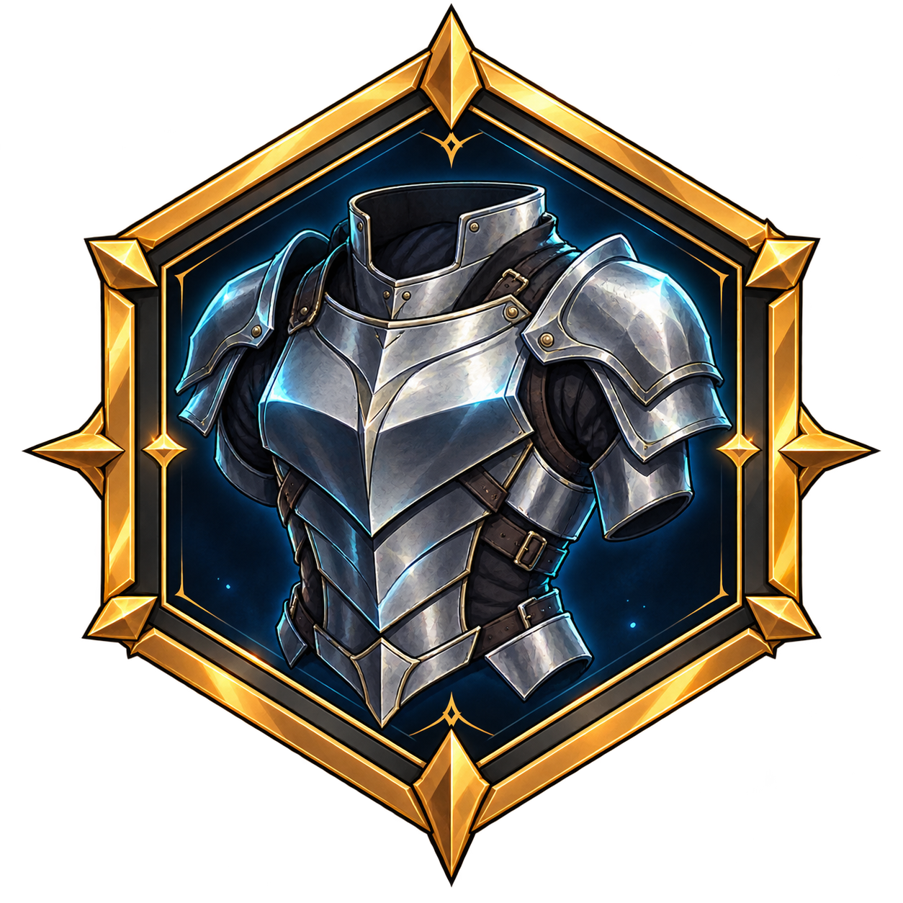
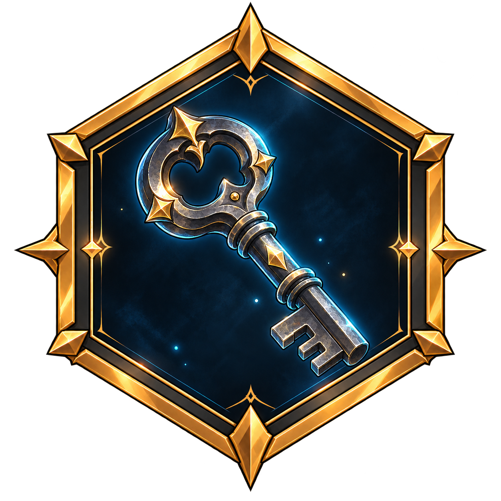
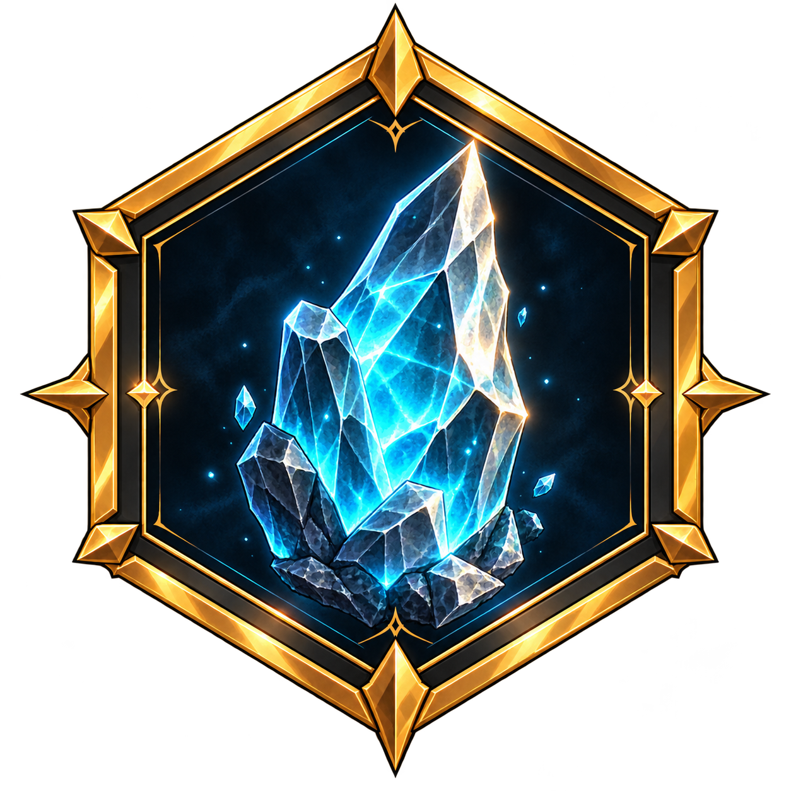
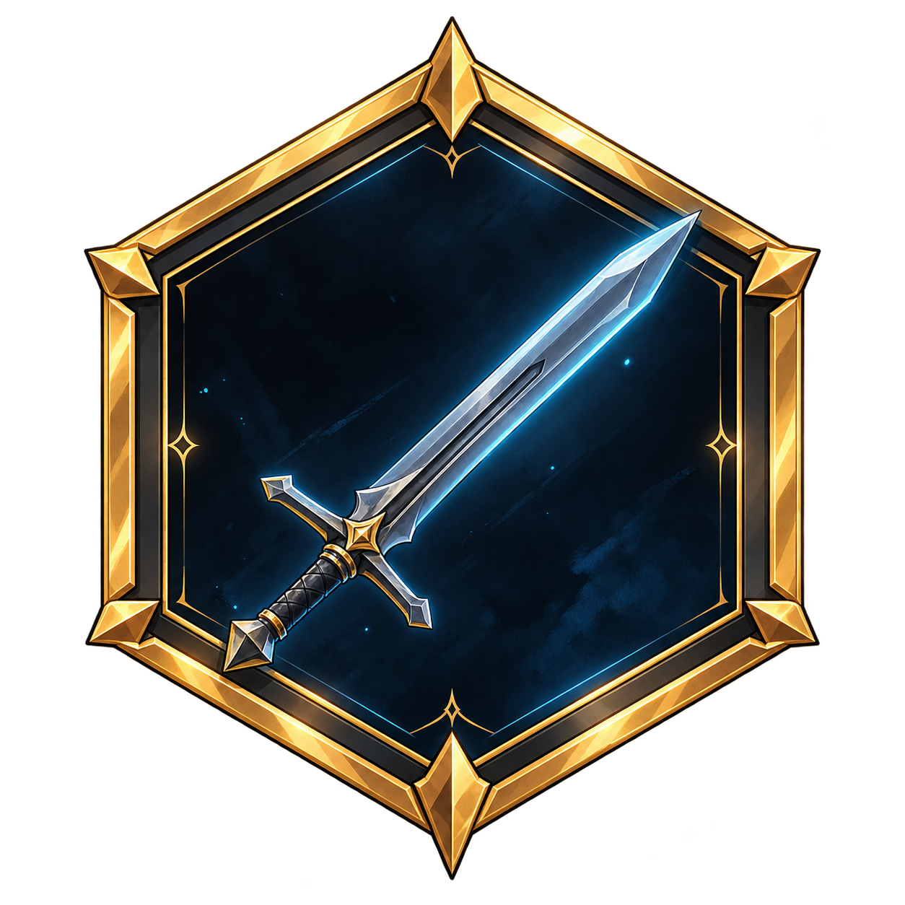
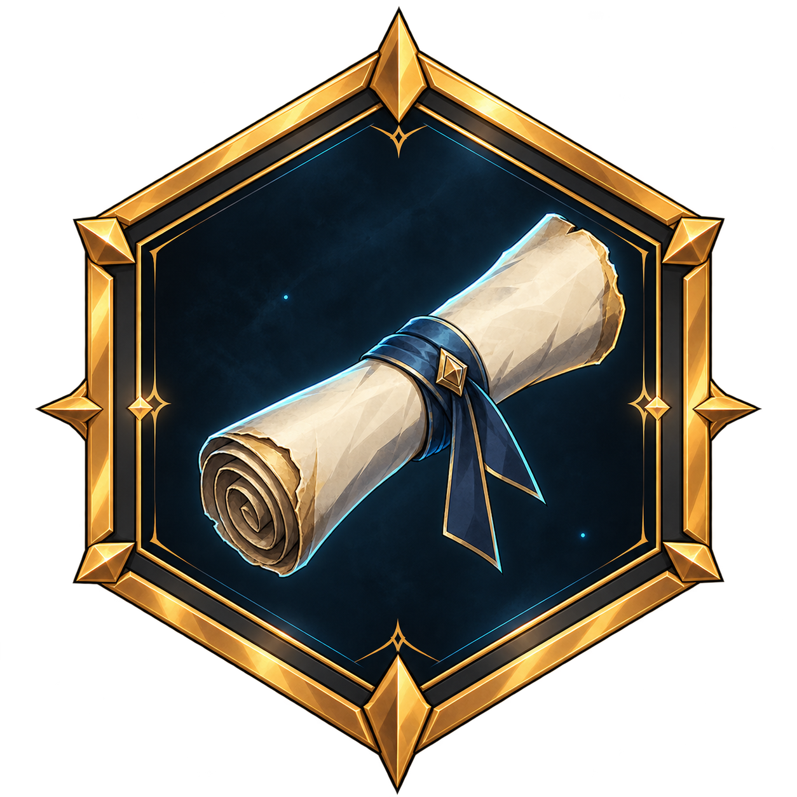

<h1 align="center">The Glory Online: Project Aincrad</h1>

<p align="center">
  
</p>

<p align="center"><em>Sistema de Foundry VTT do RPG de fãs The Glory Online. A ficha SAO é a porta de entrada; itens, inventário e equipamento são documentos nativos do sistema.</em></p>

<p align="center">
  
  
  
  
</p>

<p align="center">
  <a href="#-instalação">Instalação</a> ·
  <a href="#-o-que-é">O que é</a> ·
  <a href="#-como-usar">Como usar</a> ·
  <a href="#-fases">Fases</a> ·
  <a href="CHANGELOG.md">Changelog</a> ·
  <a href="#-licença">Licença</a>
</p>

> [!WARNING]
> **Em desenvolvimento.** A base (F1) e a F2 parcial (itens + edição) estão escritas e validadas em estático; o runtime no Foundry segue **em validação**. Regras em rascunho: nenhum número está fechado.

## 📥 Instalação

<p align="center">
  
</p>

No Foundry: **Game Systems → Install System → Manifest URL** e cole:

```text
https://github.com/SoftMissT/The-Glory-Online-Project-Aincrad/releases/latest/download/system.json
```

_O manifesto aponta sempre para a última release publicada._

- **[Download direto](https://github.com/SoftMissT/The-Glory-Online-Project-Aincrad/releases)** baixe o `system.zip` e extraia em `Data/systems/the-glory-online`.

Para desenvolvimento (editar e testar na hora, sem build):

```bash
git clone https://github.com/SoftMissT/The-Glory-Online-Project-Aincrad.git
cmd /c mklink /J "%localappdata%\FoundryVTT\Data\systems\the-glory-online" "C:\caminho\do\clone"
```

Editar → **F5** no Foundry.

<p align="center">
  
</p>

## 🎨 Identidade visual

<p align="center">
  
</p>

O sistema usa a mesma linguagem visual do jogo nos materiais e no HUD: fundo de Aincrad, emblema dourado, mapas e molduras de itens em azul/ciano.

<p align="center">
  
  
</p>

<p align="center">
  
  
  
  
  
  
</p>

## 🎲 O que é

- Quatro atributos, Vida e Mana
- Maestria por tipo de arma e Sword Skills
- Morte por zonas: Segura, de Ameaça e de Perigo
- Seis classes-base com trilhas
- Ficha **SAO System** com abas STATUS, INFORMATION, INVENTORY e EQUIPMENT
- Itens nativos: **arma**, **equipamento** e **consumível**, com mão esquerda/direita, dois slots de acessório e bônus de CA
- GM edita qualquer personagem; o jogador edita o próprio e coloca os itens na ficha

## 🧭 Como usar

1. Crie um mundo com o sistema **The Glory Online**.
2. **Actors → Create Actor → Personagem**.
3. Abra a ficha pelo botão ou pela tecla **M**. O painel **PLAYER SYSTEM** abre em STATUS.
4. Clique no **lápis** (barra da direita) para editar nome, nível, XP, Vida, Mana, atributos, classe e trilha. O **check** salva; o **X** descarta.
5. Em **INVENTORY**, use **NOVO ITEM** para criar arma/equipamento/consumível, ou arraste um Item da sidebar para a ficha. Em **EQUIPMENT**, clique em um slot para equipar.

## 🗺️ Fases

| Fase   | Entrega                                                                       | Estado                          |
| ------ | ----------------------------------------------------------------------------- | ------------------------------- |
| **F1** | Manifesto, modelo do personagem, ficha STATUS, tokens e lang                  | ✅ escrita, runtime em validação |
| **F2** | Tipos de item, INVENTORY/EQUIPMENT (mãos e slots) e edição na ficha SAO        | ✅ parcial, runtime em validação |
| **F3** | SKILLS + Sword Skills como dados (custo de mana, pós-atraso)                  | ⏳ pendente                     |
| **F4** | UI de mundo, ficha de guilda, relógio de boss, compêndios                     | ⏳ pendente                     |

## 🔧 Compatibilidade

| Item            | Valor               |
| --------------- | ------------------- |
| Foundry VTT     | **v14 ou superior** |
| Dependências    | Nenhuma             |
| Sistema de jogo | Este, standalone (sem dnd5e) |

## 📜 Licença

**CC0 1.0 Universal** veja [LICENSE](LICENSE).

Projeto não oficial, feito por fãs, sem fins lucrativos e sem afiliação com os detentores dos direitos de Sword Art Online ou The King's Avatar. Todos os nomes e marcas pertencem a seus respectivos donos.

<p align="center">
  Criado por <a href="https://github.com/SoftMissT">SoftMissT</a> ·
  <a href="https://github.com/SoftMissT/The-Glory-Online-Project-Aincrad/issues">Reportar bug</a> ·
  <a href="https://github.com/SoftMissT/The-Glory-Online-Project-Aincrad/releases">Releases</a>
</p>
